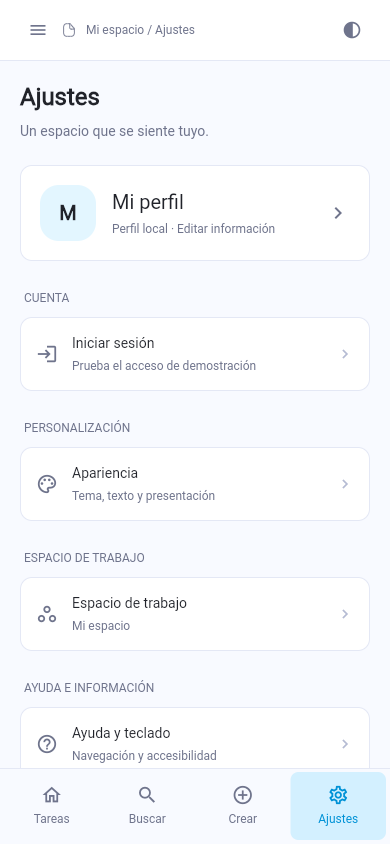
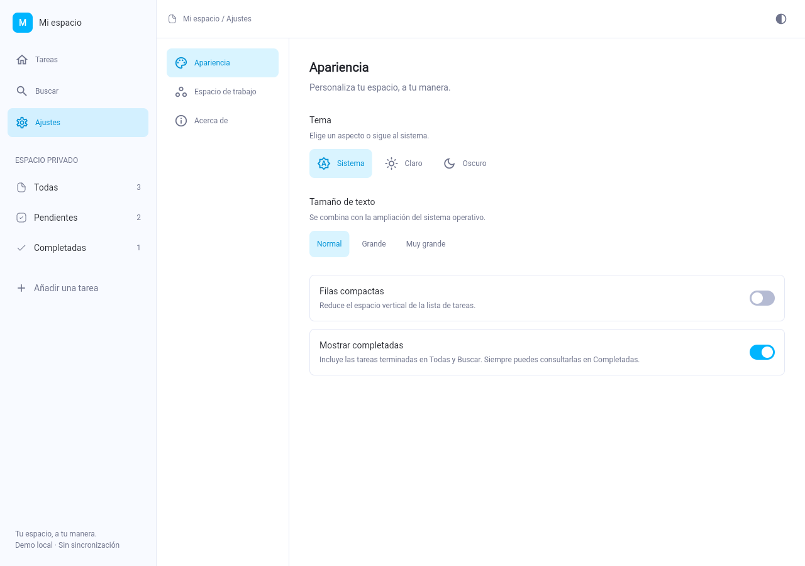
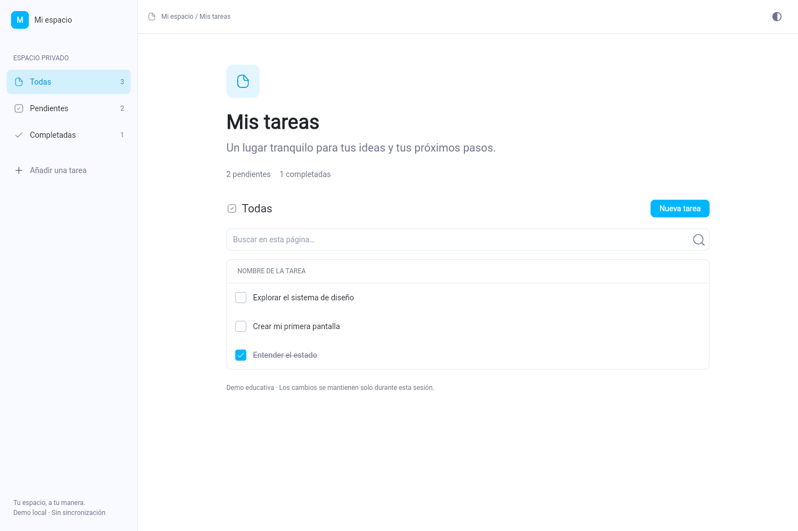

# Mi espacio · Aprender Flutter con el diseño de AppFlowy

Esta base reutiliza **el sistema visual real de AppFlowy**: el paquete `appflowy_ui`, sus temas claro/oscuro, tokens de color, tipografía, radios, botones, campos y modales. También incluye cuatro iconos SVG del proyecto original. La pantalla adapta esa base a un espacio de tareas con barra lateral, cabecera discreta, superficie plana y filas compactas.

## Base para tu próximo proyecto

`main` conserva una base Flutter general. Incluye mejoras reutilizadas del trabajo
de producto: contraste claro/oscuro, búsqueda sin tildes con limpieza, reducción de
movimiento, pausa de animaciones en páginas ocultas, información de versión y
desarrollo, licencias y configuración Android más contenida en RAM.

La identidad Flutter se edita en `lib/app_info.dart`; la versión se toma de
`pubspec.yaml`. Consulta **[qué se trasladó y cómo preparar tu fork](docs/base-handoff.md)**
para nombres nativos, iconos, firma, datos y autenticación.

**Estado actual:** cambios revisados por inspección y comprobaciones ligeras;
pruebas nuevas y compilación pendientes de autorización. No se añadieron dependencias.

## Auditoría y correcciones

Se corrigieron los cinco hallazgos de la auditoría: conservación del borrador de perfil al redimensionar, zonas táctiles mínimas, contraste, respuesta tardía del acceso y cambio de controlador del campo. Las adaptaciones del paquete original están registradas en `THIRD_PARTY.md`.

**Comprobación histórica de la base anterior:** análisis estático sin incidencias, 22 pruebas aprobadas, guías Flutter de áreas táctiles/etiquetas/contraste en los recorridos probados claro/oscuro y compilaciones debug Android y Linux. Estos resultados no verifican los cambios actuales. La ejecución en un dispositivo Android sigue pendiente. Consulta [la auditoría y sus correcciones](docs/audit-fixes.md).

## Fase 2: navegación y ajustes propios

### Vista completa de ajustes, perfil y acceso demo

La vista móvil ahora abre un **índice con tarjeta de perfil, avatar y grupos de opciones**, con pantallas de detalle y regreso. En escritorio presenta el perfil y las categorías en un menú lateral. Puedes editar nombre, descripción y color del avatar.

El inicio de sesión tiene formulario, validación, carga, errores, reintento y cierre de sesión mediante `AuthCubit` y el contrato `AuthRepository`. La implementación `DemoAuthRepository` simula una sesión; la pantalla lo indica y pide datos ficticios. Para conectar un backend se sustituye el repositorio, sin reescribir las vistas. **No verifica credenciales ni protege datos reales.**



[Perfil en escritorio](docs/profile-settings-desktop.png) · [Inicio de sesión](docs/sign-in-mobile.png) · [Arquitectura del perfil y acceso](docs/profile-auth.md).

La base ahora tiene **Tareas, Buscar, Crear y Ajustes en la barra inferior móvil**, navegación lateral en escritorio y configuración por categorías. El drawer móvil conserva los filtros de tareas. Tema, tamaño de texto, filas compactas, visibilidad de completadas y nombre del espacio modifican realmente la interfaz.

Los nuevos controles `WorkspaceChoice` y `WorkspaceToggle` están escritos en `lib/design_system/workspace_controls.dart`, componiendo `AFBaseButton`, tokens y piezas Flutter. `SettingsCubit` conserva las preferencias de sesión por encima de las pantallas; `WorkspaceCubit` conserva las tareas. No se añadieron dependencias.



[Navegación móvil](docs/phase2-mobile.png) · [Ajustes móviles](docs/phase2-settings-mobile.png) · [Tema oscuro](docs/phase2-settings-dark.png) · **[Guía de la fase 2](docs/phase2.md)**.

Las preferencias y tareas siguen en memoria: se reinician al cerrar la app. Restablecer preferencias conserva las tareas de la sesión. Las capturas siguientes corresponden a la primera fase.



[Ver la vista móvil](docs/mobile.png).

Es un proyecto independiente en `~/Projects/flutter_workspace`. No necesita la carpeta original, Rust ni el backend de AppFlowy. **No es una copia completa de AppFlowy ni de su editor.** Las tareas se mantienen en memoria y se pierden al reiniciar; la pantalla lo indica.

## Abrir y ejecutar

En Android Studio: **File → Open → `~/Projects/flutter_workspace`**. Selecciona la carpeta que contiene `pubspec.yaml`, no solamente `android/`.

```bash
cd ~/Projects/flutter_workspace
flutter pub get
flutter analyze
flutter test
flutter run -d linux
```

Para Android, inicia un emulador o conecta un teléfono con depuración USB, acepta su autorización y ejecuta:

```bash
flutter devices
flutter run -d <id-del-dispositivo>
```

En este equipo existe el emulador `Apisito`: `flutter emulators --launch Apisito`.

Las carpetas nativas de Android, iOS, Linux, macOS y Windows ya existen. iOS/macOS requieren macOS y Xcode; Windows requiere su entorno de compilación. Versiona las carpetas nativas, `.metadata` y `pubspec.lock` cuando crees tu repositorio.

## Qué se reutiliza y qué se adapta

| Pieza | Procedencia | Dónde verla |
|---|---|---|
| Paleta clara/oscura y tokens semánticos | AppFlowy con ajustes locales de contraste documentados | `packages/appflowy_ui/lib/src/theme/` |
| Tipografía, tamaños y pesos | AppFlowy; familia por defecto de la plataforma | `theme/definition/text_style/` dentro del paquete |
| Botones, hover y anillo de foco | AppFlowy | `AFFilledTextButton`, `AFOutlinedTextButton`, `AFGhostButton`, `AFBaseButton` |
| Campo y mensajes de error | AppFlowy | `AFTextField` |
| Superficie del diálogo | AppFlowy | `AFModal` |
| Iconos de página, tarea, búsqueda y confirmación | SVG originales | `assets/icons/` |
| Barra lateral y pantalla de tareas | Composición propia con componentes/tokens de AppFlowy | `lib/workspace/presentation/` |
| Estado de tareas | Cubit propio, del mismo ecosistema BLoC usado por AppFlowy | `lib/workspace/application/` |

El código de origen y su commit están registrados en [`THIRD_PARTY.md`](THIRD_PARTY.md). El paquete está dentro del proyecto como dependencia local: no hay una ruta absoluta hacia `~/Projects/AppFlowy`.

## Por qué aparece `material.dart` si el diseño es propio

Flutter ofrece las piezas para construir interfaces. `MaterialApp`, `Scaffold`, `TextField` y otros widgets también dan infraestructura: navegación, edición de texto, accesibilidad, teclado y temas del sistema.

AppFlowy también importa `material.dart`. Lo que evita el aspecto predeterminado de Material es **su sistema visual**, aplicado explícitamente a esas piezas: colores semánticos, tipografía, bordes, medidas y componentes propios. Por ejemplo, `AFTextField` usa internamente un `TextField`, pero define sus propios estilos, bordes, estados de foco y errores.

Aquí no se usa el dashboard anterior de `NavigationRail`, `NavigationBar`, tarjetas Material y `CheckboxListTile`. La interfaz visible se compone con los componentes reales de AppFlowy y sus tokens.

## Estructura: dónde vive cada responsabilidad

```text
lib/
  main.dart                              Proveedor de ajustes, temas y escala de texto
  design_system/
    theme.dart                           Puente entre Flutter y los tokens originales
    workspace_icon.dart                  Carga y coloreado de los SVG locales
    workspace_controls.dart              Opciones seleccionables e interruptor propios
  settings/
    application/settings_cubit.dart      Preferencias inmutables y validación
    presentation/settings_page.dart      Apariencia, espacio y acerca de
    presentation/settings_widgets.dart   Tarjeta de perfil, avatar y grupos
    presentation/profile_editor.dart     Edición validada del perfil local
  auth/
    application/auth_cubit.dart           Contrato, servicio demo y estados de sesión
    presentation/sign_in_page.dart        Formulario, carga y errores
  workspace/
    application/
      workspace_cubit.dart                Modelo, estado inmutable y acciones
    presentation/
      workspace_page.dart                 Composición adaptable y conexión con Cubit
      workspace_widgets.dart              Barra lateral, fila de tarea y controles
      new_task_dialog.dart                Entrada, validación y ciclo de vida del campo
packages/
  appflowy_ui/                            Componentes y temas originales
    script/                              JSON de tokens y generador original
assets/icons/                             SVG originales utilizados
test/                                     Pruebas de lógica e interacción
```

### 1. Los tokens son el vocabulario visual

Un token es un valor con una función, por ejemplo **texto secundario** o **fondo seleccionado**. Evita elegir un gris distinto cada vez que creas una pantalla:

```dart
final theme = AppFlowyTheme.of(context);

Text(
  'Mis tareas',
  style: theme.textStyle.heading1.enhanced(
    color: theme.textColorScheme.primary,
  ),
)
```

`AppFlowyDefaultTheme().light()` y `.dark()` resuelven esos nombres a colores y medidas concretos. `main.dart` introduce `AppFlowyTheme` por encima de las pantallas y rutas para que también lo reciban los diálogos.

**Para aprender:** cambia un uso de `textColorScheme.primary` a `secondary` y mira su resultado en ambos temas. Después vuelve a dejarlo como estaba.

### 2. Los componentes encapsulan el comportamiento común

```dart
AFFilledTextButton.primary(
  text: 'Nueva tarea',
  onTap: abrirDialogo,
)
```

El botón ya sabe dibujar su fondo normal, hover y foco. La pantalla le da una acción; no vuelve a implementar todos esos estados. Lee `AFBaseButton` para ver cómo combina `Focus`, `Actions`, `MouseRegion` y decoraciones de Flutter.

`WorkspaceIconButton` compone ese botón con tooltip y semántica. Las filas de tarea incluyen semántica de casilla marcada y las opciones de navegación indican cuál está seleccionada. Reutilizar un componente no sustituye la revisión de accesibilidad del conjunto.

**Para aprender:** sigue `AFFilledTextButton → AFBaseButton` y localiza dónde se decide el color al pasar el ratón.

### 3. El Cubit controla los datos; la pantalla los representa

Un `Cubit` es una clase que publica estados. La vista llama un método y recibe un estado nuevo. AppFlowy también utiliza Cubit; un ejemplo original pequeño está en `lib/workspace/application/settings/create_file_settings_cubit.dart` del repositorio original.

Flujo de una tarea en esta base:

```text
Botón → NewTaskDialog → texto validado → WorkspaceCubit.addTask
      → estado nuevo → BlocBuilder → lista y contadores actualizados
```

- `WorkspaceTask` es inmutable: sus campos son `final`.
- `WorkspaceState` expone una lista que no se puede modificar desde fuera.
- `addTask` normaliza y valida el texto antes de emitir un nuevo estado.
- `toggleTask` crea una tarea nueva en lugar de alterar la anterior.
- `BlocProvider(create: ...)` es dueño del Cubit y lo cierra al desmontarse.
- `BlocBuilder` reconstruye la interfaz cuando cambia el estado.
- La búsqueda y el filtro seleccionado son estado visual temporal, mantenido con `setState`.

No hace falta añadir Freezed, GetIt ni servicios vacíos para aprender este flujo. AppFlowy usa esas herramientas para necesidades mayores. Añádelas cuando puedas explicar qué problema concreto resuelven en tu aplicación.

**Para aprender:** implementa editar un título con el mismo patrón de estado inmutable y añade una prueba que compruebe que el estado anterior no se modificó.

### 4. La adaptación depende del espacio disponible

`LayoutBuilder` mide el ancho disponible. Desde 900 px muestra una barra lateral fija; por debajo aparece la barra inferior y un panel desplegable para los filtros. La lógica de tareas permanece por encima de ese cambio, por lo que redimensionar no la reinicia. `IndexedStack` conserva el contenido de tareas y ajustes al alternar entre ellos.

`Expanded`, `Wrap` y el desplazamiento permiten distribuir el contenido sin fijar toda la pantalla en píxeles. La anchura máxima de lectura evita que las filas se alarguen demasiado en monitores grandes.

**Para aprender:** prueba 320, 900 y 1440 px; aumenta el texto; navega con Tab y Enter. Comprueba también el diálogo con el teclado de Android abierto.

### 5. Valida la entrada y libera lo que creas

`NewTaskDialog` es dueño de su `TextEditingController` y lo libera en `dispose`. Si el título está vacío, usa `AFTextFieldState.syncError`; no cierra el diálogo. La lógica vuelve a rechazar un título vacío, aunque la acción venga de otro lugar.

La pantalla comprueba `mounted` después de esperar el resultado del diálogo. Así evita acceder a un contexto que ya se desmontó.

## Personalizar el diseño sin perder consistencia

1. Reutiliza un componente existente del paquete antes de crear otro.
2. Usa roles como `fillColorScheme.contentHover` y `borderColorScheme.primary`, en vez de introducir colores sueltos.
3. Usa `theme.spacing` y `theme.borderRadius` para los elementos nuevos. Las medidas de composición de la pantalla, como el ancho de barra lateral, se definen en la presentación.
4. Para experimentar con una paleta propia, modifica los JSON de `packages/appflowy_ui/script/` y ejecuta el generador desde esa carpeta de paquete:

   ```bash
   cd packages/appflowy_ui
   dart run script/generate_theme.dart
   ```

   El generador vuelve a producir los archivos de tokens. Conserva tus cambios y revisa el diff antes de actualizar el paquete desde AppFlowy.
5. Verifica tema claro/oscuro, navegación por teclado, texto ampliado, estados vacíos y errores.

## Qué estudiar, en orden

1. **Dart:** tipos, null safety, clases, listas, `final`, funciones y `async/await`.
2. **Flutter:** árbol de widgets, `BuildContext`, constraints, composición y ciclo de vida.
3. **Diseño:** tokens, jerarquía tipográfica, espaciado, foco y estados de interacción.
4. **Estado:** inmutabilidad, Cubit, `emit`, `BlocProvider` y `BlocBuilder`.
5. **Datos:** añadir persistencia con manejo de errores y una prueba de restauración.
6. **AppFlowy avanzado:** BLoC con eventos, Freezed, servicios, GetIt, navegación y backend Rust.

En el proyecto original `~/Projects/AppFlowy`, empieza por:

- `frontend/appflowy_flutter/lib/startup/tasks/app_widget.dart`: tema y proveedores.
- `frontend/appflowy_flutter/packages/appflowy_ui/lib/src/theme/`: sistema visual.
- `frontend/appflowy_flutter/packages/appflowy_ui/lib/src/component/`: componentes.
- `frontend/appflowy_flutter/lib/workspace/application/settings/create_file_settings_cubit.dart`: Cubit pequeño.
- `frontend/appflowy_flutter/lib/workspace/application/view_title/view_title_bloc.dart`: eventos, estado, suscripción y limpieza.

Recursos: [Dart](https://dart.dev/language), [Flutter](https://docs.flutter.dev/get-started/fundamentals), [constraints](https://docs.flutter.dev/ui/layout/constraints), [BLoC](https://bloclibrary.dev/), [pruebas](https://docs.flutter.dev/testing/overview).

## Entorno del equipo

- Flutter estable: `~/.local/share/flutter`.
- Android Studio: `/opt/android-studio`, con plugins Flutter y Dart.
- Android SDK: `~/Android/Sdk`.
- JDK usado por Flutter: `~/.jdks/jbr-21.0.11`.
- Fish: `~/.config/fish/conf.d/flutter.fish`.
- Chromium: `CHROME_EXECUTABLE=/usr/bin/chromium`.

`flutter doctor -v` permite revisar el estado actual. Los pasos de reconstrucción del entorno se documentan en `~/dotfiles/install/README.md`; los SDK no se incluyen dentro de esta app.

## Alcance y licencia

Esta primera base enseña la UI y el flujo de estado. Antes de guardar trabajo real, añade persistencia con recuperación de errores. Autenticación, colaboración, sincronización y editor de bloques requieren implementar sus funcionalidades; copiar el sistema visual no las proporciona.

El código y los recursos extraídos de AppFlowy se distribuyen bajo las condiciones AGPLv3 del proyecto de origen. Esta base conserva esa licencia en `LICENSE`. La AGPL permite actividad comercial con sus obligaciones de redistribución/código fuente; no es una licencia para convertir un derivado en código cerrado. Consulta [`THIRD_PARTY.md`](THIRD_PARTY.md) y revisa las licencias de las dependencias que añadas.
